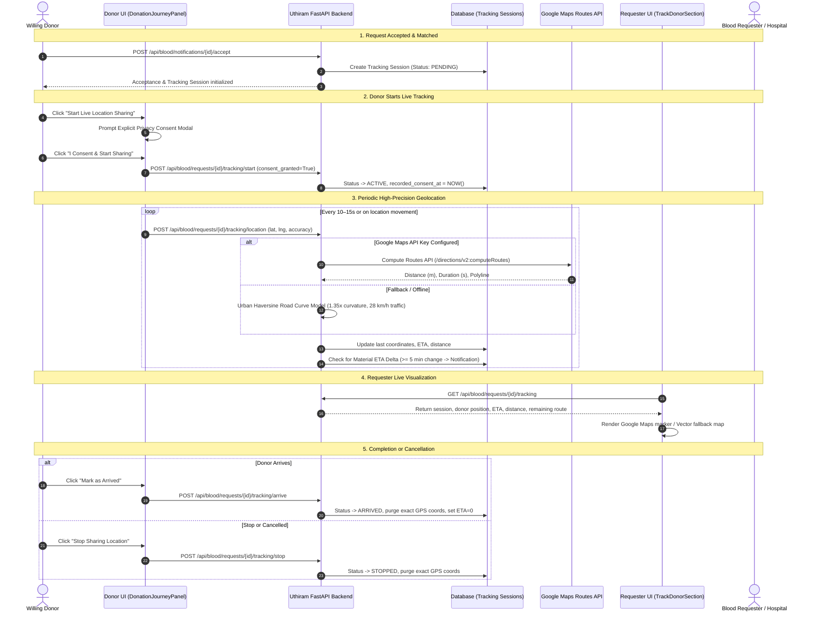

# Live Donor Tracking & Estimated Time of Arrival (ETA) in Uthiram

This document outlines the architecture, setup, security configurations, privacy compliance, and verification procedures for the **Live Donor Tracking and ETA** feature integrated into Uthiram.

---

## 1. Architecture & Workflow



---

## 2. Google Cloud Platform Configuration

### Step 2.1: Enable Required APIs
1. Navigate to the [Google Cloud Console](https://console.cloud.google.com/).
2. Select your project (e.g. `uthiram-production` or `uthiram-dev`).
3. In the sidebar, navigate to **APIs & Services** > **Library**.
4. Enable the following two APIs:
   - **Maps JavaScript API** (used by the browser frontend to display the interactive map canvas, markers, and path polyline).
   - **Routes API** (`routes.googleapis.com`) (used by the FastAPI backend to calculate accurate road routes, traffic delays, distance, and duration).

### Step 2.2: Create and Secure API Keys

It is best practice to use **two distinct API keys**: one for the browser client and one for the backend server.

#### A. Frontend Browser Key (`VITE_GOOGLE_MAPS_API_KEY`)
1. In **APIs & Services** > **Credentials**, click **Create Credentials** > **API key**.
2. Name the key: `Uthiram Frontend Maps Key`.
3. Under **Application restrictions**, select **Websites (HTTP referrers)**:
   - Add your local dev URL: `http://localhost:5173/*`
   - Add your production domain: `https://uthiram.org/*` (or your domain).
4. Under **API restrictions**, select **Restrict key**:
   - Select **Maps JavaScript API**.
5. Save the key.

#### B. Backend Server Key (`GOOGLE_MAPS_API_KEY`)
1. Create a second API key named `Uthiram Backend Routes Key`.
2. Under **Application restrictions**, select **IP addresses** (specify your production server IPs).
3. Under **API restrictions**, select **Restrict key**:
   - Select **Routes API**.
4. Save the key.

---

## 3. Environment Variables

### Backend (`backend/.env`)
```bash
# Google Maps Routes API Server Key
GOOGLE_MAPS_API_KEY=AIzaSy...your-backend-routes-key...
```

### Frontend (`frontend/.env` or `.env.local`)
```bash
# Google Maps JavaScript API Client Key
VITE_GOOGLE_MAPS_API_KEY=AIzaSy...your-frontend-maps-key...
```

> [!NOTE]
> **Zero-Dependency Fallback Mode:**
> If neither key is supplied, Uthiram automatically switches to its high-precision built-in fallback mode:
> - Backend computes realistic urban road travel times using a calibrated Haversine road curvature model ($1.35 \times$ direct distance, average city speed $28 \text{ km/h}$).
> - Frontend renders a crisp, responsive SVG vector tracker showing the donor, destination hospital, relative distance vector, and live status badges.

---

## 4. Privacy, Security & RBAC Guarantees

1. **Explicit Donor Consent:**
   - No GPS coordinates are streamed until the donor clicks **"Start Live Location Sharing"** and accepts the explicit privacy disclosure modal.
   - The session records `consent_granted=True` and `recorded_consent_at` timestamp in the audit database.

2. **Role-Based Access Control (RBAC):**
   - Coordinates and tracking sessions are accessible **only** to:
     - The assigned donor for the reservation.
     - The requester who created the blood request.
     - The assigned/participating blood bank.
     - Platform administrators.
   - Any unauthorized user receives an immediate `403 Forbidden` response.

3. **Immediate Coordinate Purging:**
   - Once a donor marks arrival (`ARRIVED`), stops tracking (`STOPPED`), or if the request is cancelled or completed, live coordinates (`donor_lat`, `donor_lng`, `donor_accuracy_meters`) are **immediately zeroed out / purged** from database storage to safeguard donor location privacy.

4. **Masked Contact Information:**
   - The requester tracking view does not expose private residential addresses or unmasked donor telephone numbers. Only the assigned blood group, ETA, distance, and verified badge are presented.

---

## 5. Verification & Testing

### 5.1 Automated Backend Tests
Run the automated test suite using Python 3.11:
```bash
.\backend\.venv\Scripts\pytest.exe backend/tests/test_donor_tracking.py -v
```
All 8 test suites pass:
- Tracking session initialization upon request acceptance.
- Explicit privacy consent enforcement.
- Geolocation coordinate validation ($-90 \le \text{lat} \le 90$, $-180 \le \text{lon} \le 180$).
- Material ETA delta alert generation ($\ge 5$ minutes change).
- RBAC authorization check (donor, requester, blood bank, unprivileged user).
- Arrival marking and status progression.
- Coordinate purging on session stop.
- Google Maps Routes API integration and Haversine fallback calculations.

### 5.2 Frontend Build & Lint Verification
Run from the `frontend/` directory:
```bash
npm run build
npm run lint
```
Ensures complete TypeScript type checking, zero bundle compilation errors, and adherence to ESLint rules.

### 5.3 Interactive In-Browser Simulation
For testing without physical movement:
1. Log in as a donor with an accepted blood request.
2. Under **Active Donation Journey**, click **"Start Live Location Sharing"**.
3. Accept the consent dialog.
4. Toggle **"Simulate journey movement (Demo testing)"**.
5. Observe the live donor marker smoothly advancing toward the hospital, with distance and ETA updating every 3 seconds.
6. Open the requester dashboard in another tab to observe live updates and arrival notifications.
